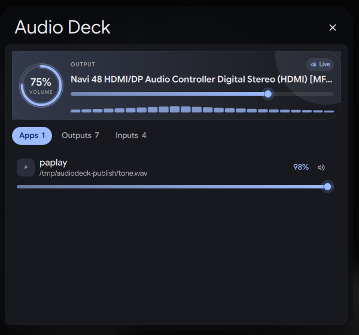

# Audio Deck

A pavucontrol-style per-app mixer for DMS / Dux Modular Shell, with live
eye candy. Mix every app that is playing, mute it, and switch outputs or
inputs without leaving the bar.

Apps and devices are read directly from PipeWire through Quickshell, so the
list follows reality: start a video and its stream appears, close the tab and
it disappears.



## Features

- **Per-app volume** — every playback stream gets its own draggable bar, from
  0 to 100% (or up to 150% if you raise the limit in settings).
- **Per-app mute** — one click on the speaker icon.
- **Outputs and inputs** — switch the default sink or source, adjust device
  volume, and mix apps that are recording.
- **Bar pill** — animated volume ring, real Cava spectrum, optional percentage.
  Scroll to change the master volume, right- or middle-click to mute.
- **Configurable spectrum** — independent Cava switches and 1–30 fps redraw
  controls for the bar pill and the opened mixer, with Battery saver (4),
  Smooth (12) and Fluent (30) presets.
- **Popout mixer** — master card, tabbed app/device lists, and status that
  updates as streams come and go.
- **Control Center** — a tile with an inline master slider and a full mixer
  page, using the same state as the bar.
- **Eye candy** — gradient level bars with glowing thumbs, animated arc rings,
  real Cava spectrum bars, animated chips and tab fades. All animation respects
  the shell's reduce-motion setting; the spectrum itself only moves when Cava
  reports live audio.
- **Reduced motion** — disable animations in the settings if you prefer a
  calm, static mixer.

## Requirements

- DMS / Dux Modular Shell **2.0.0** or newer
- PipeWire with `pipewire-pulse` and `pw-metadata` (`pipewire-utils` on
  distros that split the tools out of the main package)
- Optional: `cava` built with PipeWire input support for the live spectrum;
  without it, or while the output is silent, the bars stay static

No Python and no shell helper scripts. Cava is the only long-running optional
process; it runs only while a spectrum is mounted, visible, and an app is
actually playing audio. `pw-metadata` runs briefly when switching the default
input.

## Installation

Clone the plugin repository into your plugin directory:

```sh
git clone https://github.com/something1529-jpg/dms-audio-deck.git \
  ~/.config/DankMaterialShell/plugins/audioDeck
```

The clone destination is intentionally named `audioDeck`; DMS identifies the
plugin by the `id` in `plugin.json`, not by the repository name.

Then open **Settings → Plugins**, find **Audio Deck**, and:

1. Add it as a bar widget (Bar settings), and/or
2. Add the **Audio Deck** tile in Control Center settings.

DMS discovers the folder automatically; there is no registry entry to edit.

## Usage

| Action | Result |
|--------|--------|
| Click the bar pill | Open the mixer popout |
| Scroll the bar pill | Change the master volume |
| Right- or middle-click the pill | Mute / unmute the default output |
| **Apps** tab | One row per app currently playing |
| **Outputs** tab | All output devices; the radio circle sets the default |
| **Inputs** tab | Microphones plus apps that are recording |
| Drag a level bar | Set that app's or device's volume |
| Scroll a level bar | Step the volume by the configured amount |
| Double-click a level bar | Reset to 100% |
| Speaker / mic icon | Mute or unmute that stream |
| Ring or percentage on the master card | Click to mute, scroll to adjust |

### How streams are matched

- Playback streams (`Stream/Output/Audio`) become **Apps** rows.
- Capture streams (`Stream/Input/Audio`) become **Inputs** rows.
- Virtual loopbacks and the shell's own notification sounds are filtered out.
- Apps appear while they hold an active stream, exactly like pavucontrol.
- Devices hidden in DMS audio settings stay hidden here too.

## Settings

| Setting | Default | Description |
|---------|---------|-------------|
| Maximum volume | 100% | Upper limit for all sliders (100–150%) |
| Scroll step | 5% | Change per wheel notch (1–25%) |
| Spectrum in bar pill | On | Cava bars on the bar widget |
| Bar pill frame rate | 4 fps | Redraws per second (1–30); shared capture uses the highest enabled rate |
| Spectrum in opened mixer | On | Cava bars on the mixer master card |
| Mixer frame rate | 12 fps | Redraws per second (1–30); shared capture uses the highest enabled rate |
| Show percentage on the bar | On | Master percentage next to the pill icon |
| Smooth animations | On | Rings, meters and transitions |

## How it works

- `AudioDeckService.qml` is a shared singleton that reads
  `AudioService.pipewireNodes` and writes `PwNode.audio.volume` /
  `.muted`. Those writes go straight to PipeWire.
- Master volume is the default sink; device rows use the same API and set the
  default sink/source through `AudioService`.
- `AudioDeckMixer.qml` is the shared UI used by both the popout and the
  Control Center detail page.
- `AudioDeckCava.qml` owns a private Cava process. It uses Cava's native
  PipeWire input and an explicit `source=<default-sink>.monitor`, so it reads
  the same signal as the speakers instead of the default microphone.
- The spectrum acquires that Cava only while it is mounted and visible. No
  spectrum means no Cava process, and no `CavaService` reference. The bar and
  mixer each hold their own reference and requested frame rate.
- Cava's configuration is passed through a file descriptor; the plugin does
  not create a temporary config file.
- No `pactl`/`wpctl` polling: changes made elsewhere (or by another mixer)
  show up immediately.

## Performance

- Cava runs only while an audible, unpaused playback stream exists and the
  master output is neither muted nor at 0%. One shared capture stream feeds
  both surfaces at the highest enabled spectrum rate (4 fps battery saver,
  12 fps smooth, 30 fps fluent; the sliders accept 1–30). Each surface samples
  that stream at its own redraw rate, so opening or closing the mixer never
  restarts Cava. Repeated silent frames are ignored.
- The Cava binary is probed once, lazily, only after a spectrum is actually
  shown. With the live spectrum off, or on a shell that never opens the mixer,
  no helper process is spawned at all.
- Cava starts through `sh`, not `bash`, and its config still arrives on a file
  descriptor instead of a temporary file.
- When Cava has no signal, the bars use a deterministic static shape. There is
  no idle timer, phase animation, or invented wobble.
- Stream and device lists keep their identity between PipeWire updates, so a
  volume tick updates existing rows instead of recreating them. The bar and
  Control Center labels use a precomputed app count instead of sorting the
  stream list.
- Closed popouts and Control Center detail pages release their Cava reference;
  the 3-second linger that avoids a popout-morph restart only applies while
  audio is actually audible. The bar spectrum also releases it when its window
  is hidden. Switching outputs restarts the capture stream on the new sink.
- Each spectrum bar is a single item, and animation behaviors are disabled when
  animations or reduce-motion are off.
- Row bars use a lightweight translucent halo instead of an offscreen blur
  layer per thumb.
- The master halo is static; only the volume ring animates when its value
  changes.
- No polling, temporary config files, Python, or helper daemons are used.
  `pw-metadata` is a short-lived command when the default input changes; Cava
  is the optional capture process.

## Limitations

- Audio Deck switches the **default** output or input. It does not move a
  single app's stream to a different sink; PipeWire only exposes that through
  pulse-style stream routing.
- An app that is not currently holding a stream has no row — same as
  pavucontrol.
- The Cava spectrum reflects the whole default output, not each app; app rows
  use their own gradient fill instead of a fake per-app meter.
- The live spectrum needs Cava with native PipeWire input. Without it, the
  bars remain an honest static shape; no synthetic levels are shown.
- Volume above 100% is passed to PipeWire as-is; some devices or apps may
  clamp it.

## Privacy

Everything stays local. The plugin makes no network requests, writes no logs
or files, and reads only audio node metadata already exposed by PipeWire.

## License

MIT. See [LICENSE](LICENSE).
